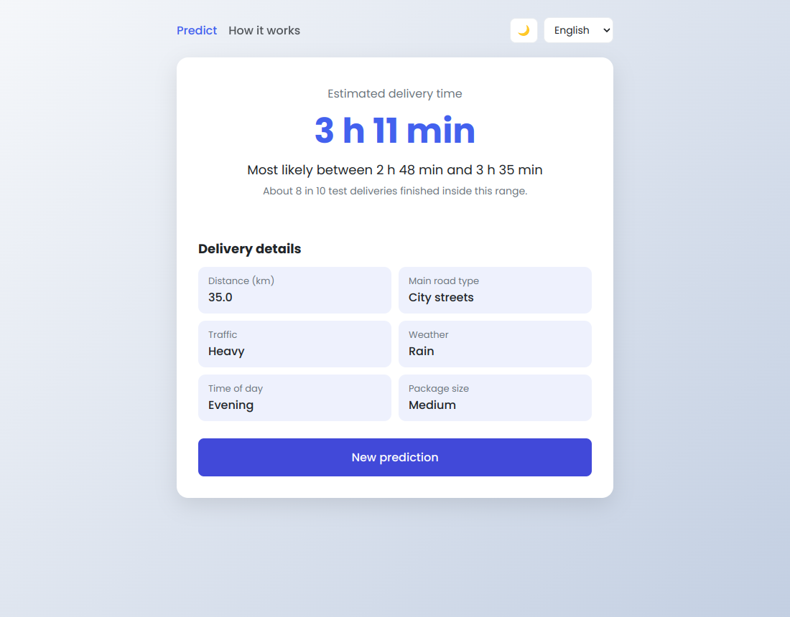
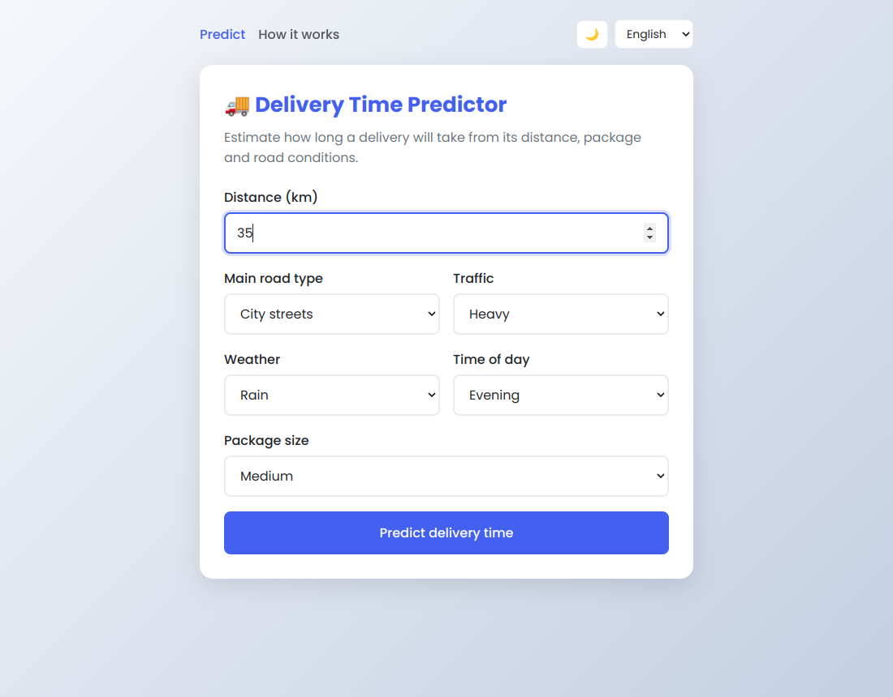
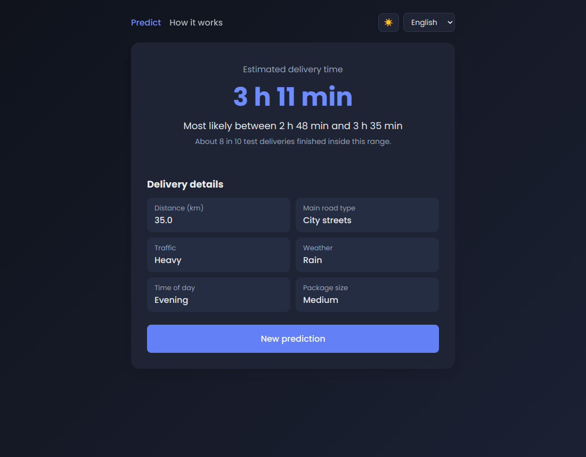
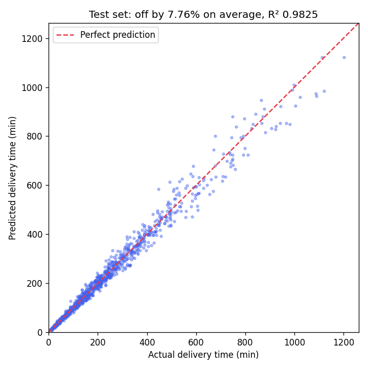
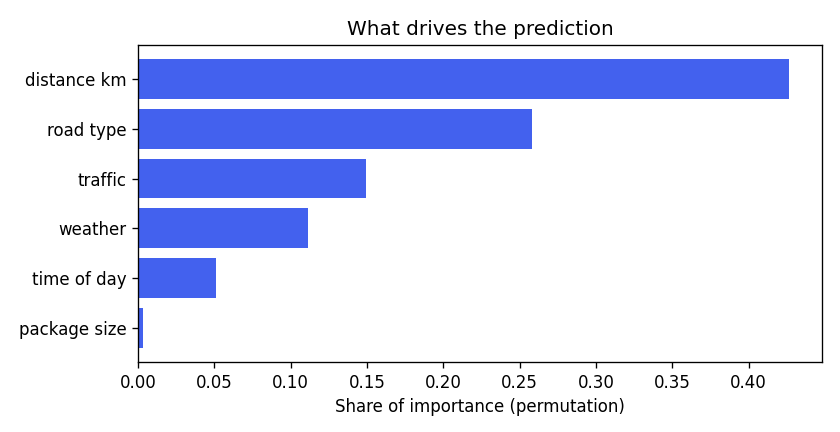

# Delivery Time Predictor

[](https://github.com/besnikemini5/delivery-time-predictor/actions/workflows/ci.yml)

A Flask web app that predicts how long a delivery will take from its distance, road type, traffic, weather, time of day and package size. The model is trained with scikit-learn, compared against simpler models, and gives a likely time range along with the estimate.



## Features

- Delivery time estimate with a likely range (for example "3 h 11 min, most likely between 2 h 48 min and 3 h 35 min")
- "How it works" page with the model comparison and which inputs matter most
- JSON API for predictions and model metrics
- English and Spanish interface
- Dark mode (remembers your choice, otherwise follows the system setting)
- Form validation with clear error messages
- 40 automated tests, run on every push with GitHub Actions

| Form | Dark mode |
|------|-----------|
|  |  |

## Tech

Python, scikit-learn, pandas, NumPy, Flask, Jinja templates, plain CSS/JS, Matplotlib (charts), pytest, GitHub Actions.

## About the data

There is no public dataset with exactly these features, so the training data is synthetic. `delivery_predictor/data.py` generates 5,000 deliveries from a simple model of how a delivery works:

```
minutes = handling time (by package size)
        + distance / average speed (by road type) × traffic × weather × time-of-day factors
```

About 8% random variation is added on top, because real deliveries with the same conditions never take exactly the same time. This means the predictions show how the model behaves, not real courier times. The useful part is the workflow: generating data, training and comparing models properly, measuring how wrong they are, and serving the result in an app.

## The model

The data is split 80/20 into a training set and a test set the models never see during training. Four models are compared on the test set:

| Model | Average error (min) | Average error (%) | R² |
|-------|--------------------:|------------------:|---:|
| Mean baseline (always predicts the average) | 153.58 | 180.6% | 0.00 |
| Linear regression | 48.44 | 29.6% | 0.88 |
| Random forest | 21.11 | 10.4% | 0.97 |
| **Gradient boosting** (used by the app) | **16.83** | **7.8%** | **0.98** |

A few choices that made a difference:

- **Predicting log(minutes) instead of minutes.** The factors multiply (heavy traffic and snow together slow a delivery down much more than either alone). Taking the log turns those products into sums, which the models handle better.
- **An honest range.** The likely range comes from how far off the model was on deliveries it didn't see during training (5-fold cross-validation), measured as a ratio so it scales with longer trips. On the test set the range contained the real delivery time for **80.2%** of deliveries, matching the 80% it was designed for.
- **Permutation importance** to see what drives the predictions: distance matters most, then road type, traffic and weather. Package size barely matters, which fits the data, since it only changes handling time by a few minutes.





## Running it locally

You need Python 3.10 or newer.

```bash
git clone https://github.com/besnikemini5/delivery-time-predictor.git
cd delivery-time-predictor
python -m venv .venv
```

Activate the virtual environment:

```bash
# Windows (PowerShell)
.venv\Scripts\Activate.ps1

# macOS / Linux
source .venv/bin/activate
```

Then:

```bash
pip install -r requirements-dev.txt
flask --app delivery_predictor run
```

Open http://localhost:5000. The first start trains the model automatically (a few seconds). To retrain it yourself and see the comparison table and charts:

```bash
python -m delivery_predictor.training --plots
```

## API

```bash
curl -X POST http://localhost:5000/api/predict \
  -H "Content-Type: application/json" \
  -d '{"distance_km": 35, "road_type": "urban", "traffic": "heavy", "weather": "rain", "time_of_day": "evening", "package_size": "medium"}'
```

```json
{
  "predicted_minutes": 190.7,
  "likely_range": {"low": 168.2, "high": 215.2},
  "inputs": {"distance_km": 35.0, "road_type": "urban", "traffic": "heavy", "weather": "rain", "time_of_day": "evening", "package_size": "medium"},
  "model": {"name": "Gradient boosting", "test_mae_minutes": 16.83}
}
```

| Field | Allowed values |
|-------|----------------|
| `distance_km` | 0.5 to 200 |
| `road_type` | `highway`, `urban`, `rural` |
| `traffic` | `light`, `moderate`, `heavy` |
| `weather` | `clear`, `rain`, `snow` |
| `time_of_day` | `morning`, `afternoon`, `evening`, `night` |
| `package_size` | `small`, `medium`, `large` |

Invalid input returns `400` with a message per field. `GET /api/model` returns the full training metrics.

## Tests

```bash
pytest -v
```

- `test_data.py`: the generated data has the right shape and ranges, and the formula behaves sensibly (more traffic or snow means longer, highways are faster)
- `test_model.py`: the chosen model beats the baselines, the range covers about 80% of held-out deliveries, and predictions move in the right direction when conditions change
- `test_web.py`: pages, form validation, the JSON API, the language switch, and error pages

## What changed from the first version

This project went through a couple of versions. The current one fixes the problems of the earlier ones:

- The result page used to show an "actual time" that was really the prediction plus random noise. It's replaced by a range based on the model's measured error.
- The model was never evaluated. There is now a train/test split, a baseline to compare against, and error metrics.
- The second version started adding email notifications and Google Maps distance lookup, but they were never finished (placeholder credentials, a form missing its fields). Those features were removed; the language switch and dark mode were finished.
- The training formula produced unrealistic times (a 100 km delivery in bad conditions took two days). It now uses average speeds per road type.

## Author

Besnik Emini · [GitHub](https://github.com/besnikemini5) · [LinkedIn](https://www.linkedin.com/in/besnikemini1)
